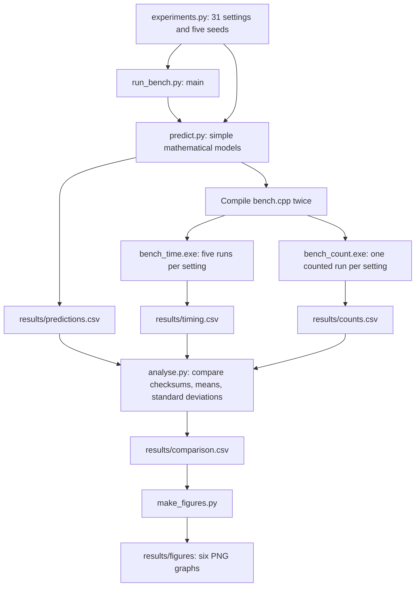

# Benchmark data flow

Start from the project folder: `python bench/run_bench.py`.
For a small check: `python bench/run_bench.py 2000` (replaces saved results).

Output paths are relative to the project root; scripts remain in `bench/`.

## Inside one C++ run

1. Python passes structure, window, retraction rate, value range, stream size,
   seed and purge factor as command-line arguments.
2. C++ generates values and retraction IDs before starting the timer. Matching
   parameters and seed generate matching inputs for A and B.
3. It records baseline process memory and times construction separately.
4. Each replay step calls `add(value)`, optionally `retract(id)`, then `get()`.
   These methods are defined in `src/structA/medianA.h` and
   `src/structB/medianB.h`; their .cpp files are demos.
5. C++ prints one CSV line. Python captures it with `subprocess.check_output`.
6. Python saves five timing rows and one counter row for each setting.

## Functions kept in the runner

- `main()`: runs the workflow in order and writes CSV files.
- `build_benchmarks()`: compiles timing and counting versions.
- `run_setting()`: runs one executable and splits its CSV output into fields.
- `run_script()`: starts another Python script using the current Python interpreter.

These helpers avoid repeating commands. Python's `with open(...)` automatically
closes the CSV files before analysis reads them. An unsuccessful subprocess stops
the workflow instead of generating graphs from incomplete results.

## Reading a row

`timing.csv`: experiment name, seven input settings, seven measured results.
The measured results are construction ms, replay ms, ns/step, extra peak KiB,
checksum, successful retractions and distinct-value count.

`counts.csv`: experiment name, seven input settings, the distinct-value count and six operation counts per step.
A uses heap comparisons, heap swaps, hash probes and purge scans. B uses Fenwick
steps and binary-search steps. Unused columns are blank.

`analyse.py` groups the five seeds for each setting, computes mean and sample
standard deviation, converts KiB to decimal MB, and joins predictions by setting.
The checksum comparison is a smoke check; the oracle test checks individual answers.

`make_figures.py` selects rows by experiment and structure. Dashed lines/shaded
bands represent predictions; measured points/error bars show mean and spread.
