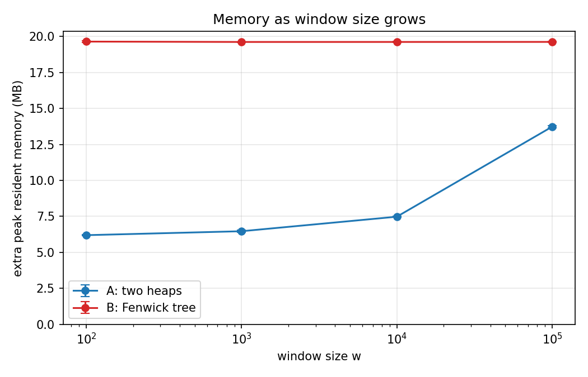
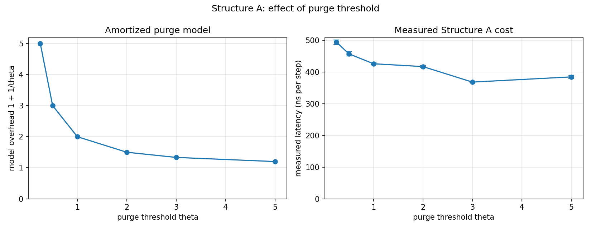

# Graph analysis and conclusions

This analysis uses the current comparison.csv: 1,000,000 replay steps per run and five timing seeds per setting. A step adds one double reading, optionally retracts an ID, then requests the median. Blue represents A (two heaps); red represents B (Fenwick tree). Error bars show one sample standard deviation across the five runs, not confidence intervals. Lower latency and lower memory are better.

Construction and B's coordinate compression are measured separately and excluded from the plotted replay latency. Memory means extra peak process working set relative to a pre-construction baseline, converted to decimal MB. It includes implementation bookkeeping and is an approximate process metric, not isolated data-structure allocation size.

## 1. Latency versus window size

The horizontal axis is window size w on a logarithmic scale. The vertical axis is mean nanoseconds per replay step. Retraction probability is 10%, value range is 1,000,000 and purge factor is 2.

| Window | A latency (ns) | B latency (ns) | B/A speedup ratio |
|---:|---:|---:|---:|
| 100 | 794.28 | 1237.49 | 1.558 |
| 1,000 | 744.69 | 686.47 | 0.922 |
| 10,000 | 443.26 | 486.74 | 1.098 |
| 100,000 | 438.74 | 469.02 | 1.069 |

A is faster in three of four measured settings; B is faster at w=1,000. Several differences are small relative to run-to-run spread. Both curves unexpectedly decrease as the window grows. This does not demonstrate that larger windows intrinsically make the algorithms faster: sequential execution, changing machine load or other runtime effects may influence these measurements. Their causes were not measured.

The operation counters provide a clearer complexity trend: A rises from 32.891 to 59.266 selected events per step, while B remains around 79. B's U stays about 632,316, so its logarithmic domain cost changes little with w. Conclusion: this timing sweep alone does not verify A's logarithmic growth; it should not be used to claim decreasing asymptotic cost.

## 2. Memory versus window size

This uses the same settings as graph 1. A's measured extra peak resident memory rises from 6.196 MB at w=100 to 13.731 MB at w=100,000. B stays approximately constant at 19.62-19.65 MB because its compressed universe and stream length are nearly fixed.

A uses less measured memory throughout this sweep. The growing heap allowance explains the direction of A's trend, while B's domain arrays depend primarily on U. Neither implementation uses only window-sized storage: retained per-arrival metadata contributes O(N). These process measurements are consistent with O(N+w) for A and O(N+U) for B, but measurements at fixed N cannot prove those bounds.

## 3. Latency versus retraction probability

The horizontal axis is the probability of requesting a retraction, not the fraction of requests that successfully remove a live reading. Window size is 10,000, range is 1,000,000 and purge factor is 2.

A increases from 409.02 ns at 0% to 484.29 ns at 90%; B increases from 447.90 to 483.32 ns. Intermediate points are not monotonic. At 90%, their means differ by only 0.97 ns, well within the observed variation. A's B/A ratio falls from 1.095 at 0% to 0.998 at 90%, so its initial advantage disappears in this sweep.

A's selected operation count rises from 48.251 to 67.802 events per step. B's stays near 79.6. B already performs expiry removals in steady state; a successful explicit retraction can replace a later expiry removal, so a higher request rate need not proportionally increase total tree work. Conclusion: A becomes more expensive under heavier retraction traffic in aggregate, while B's counted workload is relatively stable. The measurements do not establish a universal winner.

## 4. Memory versus retraction probability

A decreases from 7.463 MB at 0% to 7.065 MB at 90%, approximately a 5.3% reduction. B remains around 19.61-19.65 MB. More retractions can reduce live heap occupancy in A, while B retains its compressed values and frequency array even when fewer readings are live.

Conclusion: A is more memory-efficient for these fixed-large-domain workloads. Retractions do not substantially shrink B's allocated domain storage. The modest change in A's process memory should not be interpreted as an exact count of reclaimed heap entries.

## 5. Structure A purge threshold

The left panel plots the model 1+1/theta; the right panel plots measured latency. Here theta=purge_factor-1. Increasing theta allows more dead entries before rebuilding.

| theta | Model overhead | Purge scans per step | Latency (ns) | Memory (MB) |
|---:|---:|---:|---:|---:|
| 0.25 | 5.000 | 4.925 | 493.86 | 7.157 |
| 0.5 | 3.000 | 2.941 | 456.98 | 7.242 |
| 1 | 2.000 | 1.960 | 425.65 | 7.419 |
| 2 | 1.500 | 1.457 | 416.74 | 7.838 |
| 3 | 1.333 | 1.295 | 367.87 | 8.028 |
| 5 | 1.200 | 1.142 | 384.21 | 8.700 |

The counted purge scans closely follow the decreasing amortized model. Latency generally improves, but rises again at theta=5. Memory increases as more dead entries are permitted. The best observed latency is theta=3 (purge factor 4), not the largest tested threshold.

Conclusion: purge threshold creates a time-memory tradeoff. A loose threshold reduces rebuild work but can increase heap/storage costs. This experiment supports the amortized purge model, while showing that it does not capture every component of runtime. Theta=3 is the best measured choice for this workload only.

## 6. Structure B cost versus compressed universe

Both panels use log2(U+1) on the horizontal axis. The left compares the simple 3*log2(U+1) reference with counted Fenwick/binary-lifting events; the right shows latency. Window size is fixed at 100.

| Actual U (counted seed) | Counted events per step | Latency (ns) | Memory (MB) |
|---:|---:|---:|---:|
| 100 | 28.255 | 135.65 | 9.093 |
| 1,000 | 40.093 | 180.81 | 9.517 |
| 10,000 | 55.699 | 240.40 | 9.549 |
| 99,995 | 68.250 | 311.10 | 11.109 |
| 632,316 | 79.720 | 510.99 | 19.626 |

Counted work grows approximately with log U, supporting the Fenwick update/rank-search complexity. The measured count is above the reference curve because the coefficient 3 is an illustrative trend score; a replay step can involve expiry, retraction and two middle-rank searches. It is not an exact event-count prediction.

Latency and memory both increase as the universe grows. The largest-domain latency increase is stronger than the counter increase; cache or memory-access effects are plausible explanations, but were not profiled here. Conclusion: B is particularly efficient with a small known domain; large U increases both its work and storage.

## Overall conclusions

1. A uses less measured resident memory in every paired setting here. B retains storage for the full known compressed universe.
2. A has lower mean replay latency in most paired settings, but some differences are small compared with variability. There is no universal timing winner.
3. Heavy retraction traffic removes A's timing advantage in the measured retraction sweep; at 90% the means are effectively tied at this measurement resolution.
4. A's purge experiment supports the predicted amortized rebuild tradeoff. Larger thresholds reduce purge work but increase memory; the fastest tested setting is purge factor 4.
5. B's counted work follows the expected logarithmic dependence on U. Its small-domain run reaches about 7.37 million steps/second, while its largest-domain run reaches about 1.96 million.
6. The window timing sweep contains substantial order/runtime variation and cannot by itself confirm the theoretical latency trend. Randomizing experiment order and repeating the sweep would strengthen that comparison.

These conclusions apply to this implementation, machine and generated workload. Construction costs, correctness testing and resident-memory limitations must be considered alongside replay latency. Formula derivations are in [bench/FORMULAS.md](../bench/FORMULAS.md); raw runs are in [timing.csv](timing.csv), instrumented measurements in [counts.csv](counts.csv), and graph inputs in [comparison.csv](comparison.csv).
