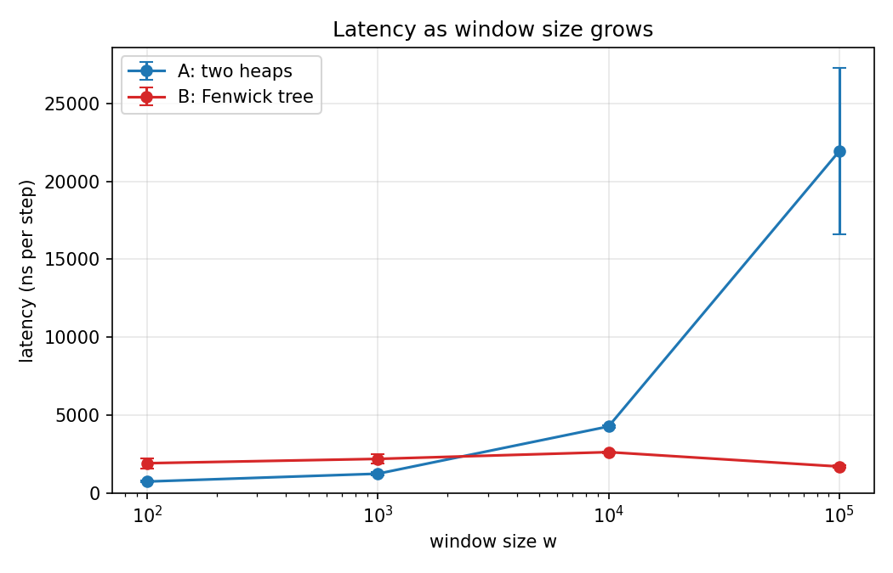
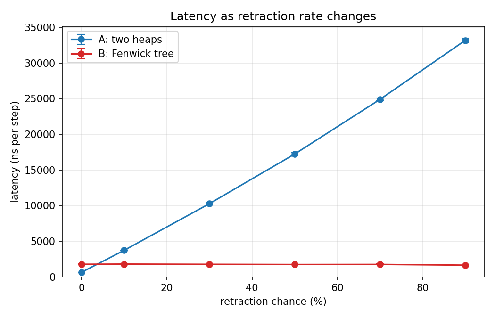
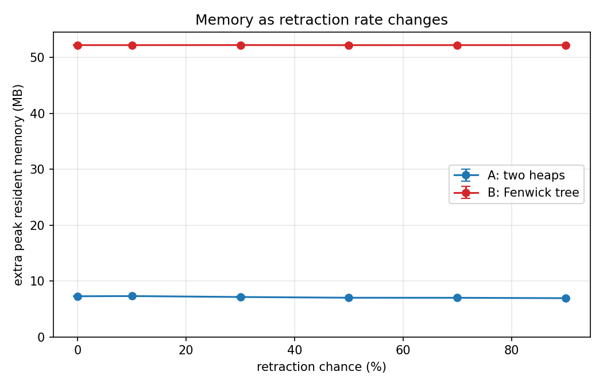
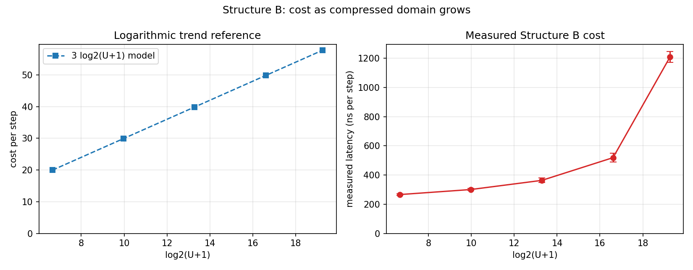

# Team implementation benchmark results

One million steps per run, five timing seeds, 31 settings across four experiment families. Each step adds a double, optionally retracts an ID, and requests the median. Operation counting has been removed.

Source: GitHub main commit 54ed2b5. A uses the team RunningMedian implementation with integration fixes. B uses the latest team value/active-pair storage, hash compression and two-search median implementation with ID and expiry corrections. See ../bench/TEAM_INTEGRATION.md. These are corrected integration copies, not unmodified upstream files.

Latency excludes input generation and construction. Memory is approximate extra peak process working set, not exact allocations. Error bars are sample standard deviations over five seeds.

## Window size

| Structure | Setting | Mean ns/step | SD ns | Memory MB |
|---|---:|---:|---:|---:|
| A | 100 | 731.27 | 53.29 | 6.518 |
| B | 100 | 1907.3 | 323.82 | 52.22 |
| A | 1000 | 1233.0 | 96.42 | 6.541 |
| B | 1000 | 2184.49 | 290.16 | 52.222 |
| A | 10000 | 4265.03 | 95.65 | 7.288 |
| B | 10000 | 2618.73 | 53.58 | 52.204 |
| A | 100000 | 21931.76 | 5319.09 | 30.247 |
| B | 100000 | 1695.18 | 74.29 | 52.195 |

Window graphs vary w while holding the generated domain and retraction probability fixed. A heap occupancy depends on w. B domain storage depends on U. Timing can also reflect cache, allocation and machine-load effects; a finite sweep does not prove an asymptotic bound.

## Retraction probability

| Structure | Setting | Mean ns/step | SD ns | Memory MB |
|---|---:|---:|---:|---:|
| A | 0 | 633.89 | 29.91 | 7.267 |
| B | 0 | 1761.16 | 57.26 | 52.192 |
| A | 10 | 3718.99 | 24.01 | 7.301 |
| B | 10 | 1785.95 | 89.46 | 52.191 |
| A | 30 | 10265.87 | 158.64 | 7.135 |
| B | 30 | 1755.51 | 77.16 | 52.201 |
| A | 50 | 17229.04 | 224.94 | 7.003 |
| B | 50 | 1729.34 | 42.96 | 52.188 |
| A | 70 | 24894.6 | 201.41 | 6.993 |
| B | 70 | 1741.08 | 72.47 | 52.193 |
| A | 90 | 33180.76 | 317.6 | 6.926 |
| B | 90 | 1638.91 | 79.2 | 52.199 |

The x-axis is retraction request probability, not successful deletion fraction. A successful retraction may replace a later expiry removal. Do not assume runtime must grow linearly with request probability.

## A purge threshold

| Structure | Setting | Mean ns/step | SD ns | Memory MB |
|---|---:|---:|---:|---:|
| A | 1.25 | 5885.0 | 26.46 | 7.08 |
| A | 1.5 | 5154.42 | 75.49 | 7.051 |
| A | 2.0 | 3681.89 | 61.79 | 7.301 |
| A | 3.0 | 1870.49 | 23.0 | 7.318 |
| A | 4.0 | 1253.43 | 36.33 | 7.505 |
| A | 6.0 | 734.38 | 15.51 | 7.833 |

Lowest mean latency in this sweep: purge factor 6.0 (alpha=5.0), 734.38 ns/step. Larger alpha permits more dead entries and lowers the rebuild-overhead reference 1+1/alpha. Actual latency also includes hash-table maintenance, including rehashing, so the reference is not a complete runtime model.

## B compressed universe

| Structure | Setting | Mean ns/step | SD ns | Memory MB |
|---|---:|---:|---:|---:|
| B | 100 | 266.08 | 5.9 | 16.859 |
| B | 1000 | 300.51 | 7.26 | 16.908 |
| B | 10000 | 363.33 | 15.53 | 17.691 |
| B | 99995 | 518.85 | 29.86 | 22.286 |
| B | 632248 | 1208.71 | 38.26 | 52.199 |

The left panel shows a dimensionless logarithmic reference, not counted operations. The right panel shows measured latency against log2(U+1). U is averaged across timing seeds. Larger U changes both tree traversal depth and hash/domain memory.

## Conclusions

A has lower mean latency in 3 of 10 paired settings. This is a comparison of means, not a statistical significance test.

Choose based on the actual workload and domain size. Inspect the memory and timing tables together. The purge setting trades retained heap entries against rebuilding work. B needs a known finite domain. These results replace the earlier local-implementation measurements.

Raw data: timing.csv. Aggregated measurements: comparison.csv. Mathematical references: predictions.csv. Definitions and derivations: ../bench/FORMULAS.md.
